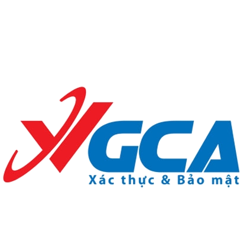
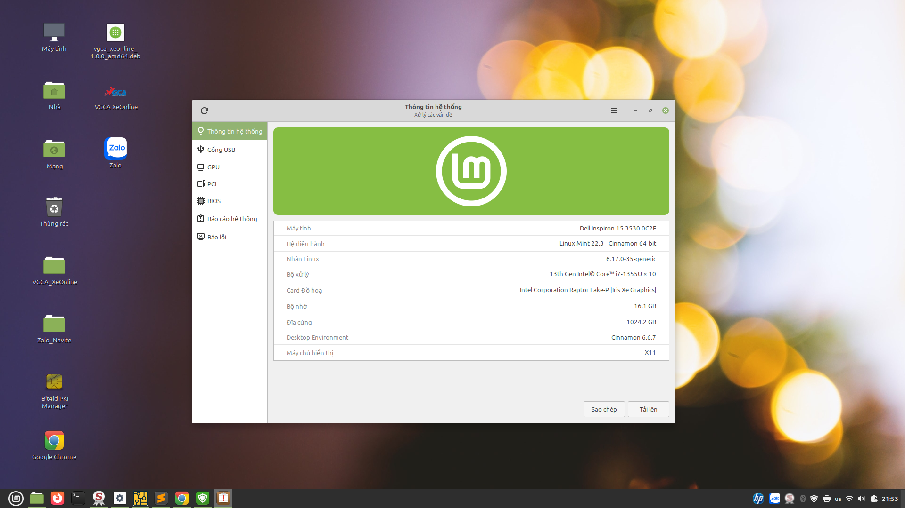
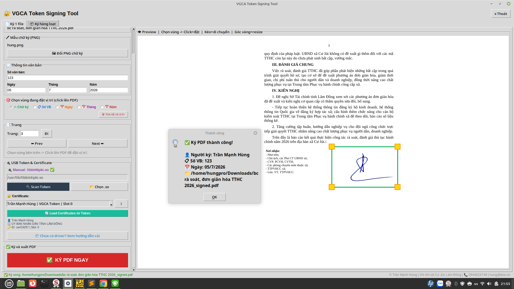
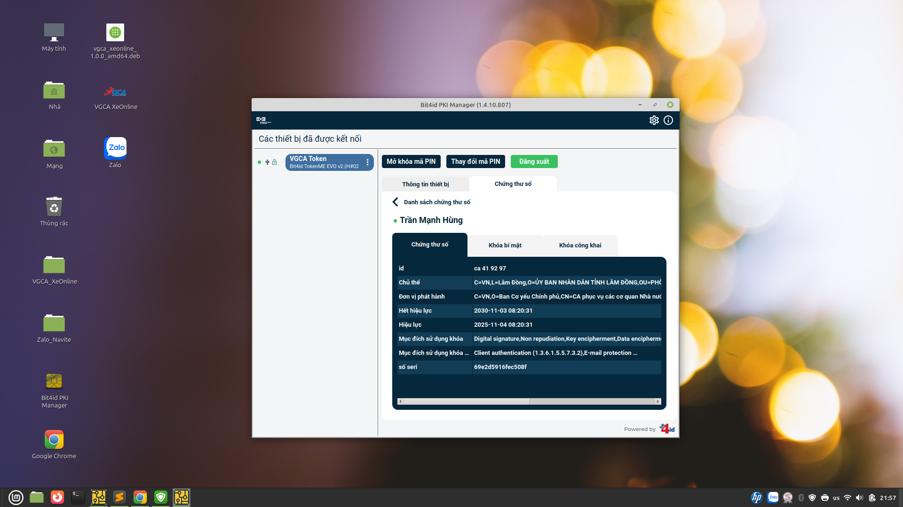
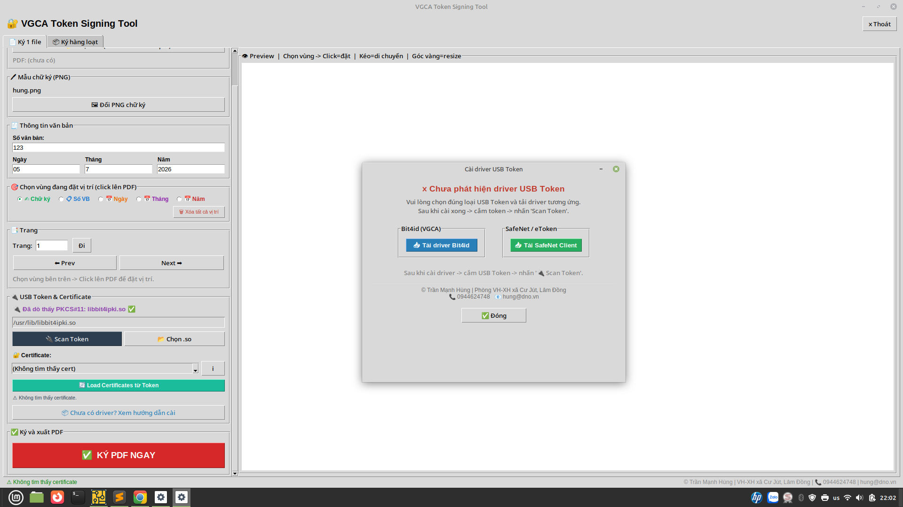

<div align="center">



# VGCA XeOnline

### Linux Digital Signature Platform

Open-source digital signature platform for Linux based on PKCS#11.


[](https://github.com/TranManhHungDNO/VGCA_XeOnline/releases)
---

**PKCS#11 • PDF Signing • USB Token • Native Messaging • Chrome Extension**

*"Bringing Digital Signatures to Linux."*

> ### 🔗 Fork notice
> Đây là bản **fork** từ [TranManhHungDNO/VGCA_XeOnline](https://github.com/TranManhHungDNO/VGCA_XeOnline)
> của tác giả **Trần Mạnh Hùng**, được **chỉnh sửa và bổ sung** bởi **DuongHp**.
> Xem chi tiết tại mục [Nguồn gốc & thay đổi](#-nguồn-gốc--thay-đổi).

</div>

---

# 📑 Table of Contents

- Fork notice / Nguồn gốc & thay đổi
- Introduction
- Why VGCA XeOnline?
- Features
- Screenshots
- Supported USB Tokens
- Architecture
- Installation
- Project Structure
- Documentation
- Roadmap
- Contributing
- License

---

# 🔗 Nguồn gốc & thay đổi

**Repo này (`DiSign`) là bản fork, không phải dự án gốc.**

| | |
|---|---|
| Dự án gốc | [TranManhHungDNO/VGCA_XeOnline](https://github.com/TranManhHungDNO/VGCA_XeOnline) |
| Tác giả gốc | **Trần Mạnh Hùng** — Phòng VH-XH xã Cư Jút, Lâm Đồng · 📞 0944624748 · 📧 hung@dno.vn |
| Bản fork | [OceanHpCK/DiSign](https://github.com/OceanHpCK/DiSign) — chỉnh sửa bởi **DuongHp** |
| Giấy phép | MIT (theo dự án gốc) |

Toàn bộ kiến trúc, GUI, engine ký PDF và phần hỗ trợ Bit4id/SafeNet là công của tác giả gốc.
Các thay đổi trong bản fork này:

- ✅ Thêm hỗ trợ USB Token **Viettel-CA / VNPT-CA** (chip Feitian ePass2003, Watchdata)
- ✅ Tự dò thêm module `libcastle*.so*`, `libwdpkcs*.so*` và các lib có đuôi version
- ✅ Lọc chứng thư CA bằng **X.509 BasicConstraints** thay vì so khớp từ khóa theo tên
- ✅ Giữ lại chứng thư không có `CKA_ID` (ký theo `label`) thay vì bỏ qua
- ✅ Thêm hướng dẫn cài đặt Viettel-CA trên Linux ngay trong ứng dụng

Nếu bạn dùng/thấy hữu ích, hãy star [dự án gốc](https://github.com/TranManhHungDNO/VGCA_XeOnline) để ủng hộ tác giả Trần Mạnh Hùng.

---

# 📖 Introduction

VGCA XeOnline is an open-source Digital Signature Platform for Linux.

The project enables applications to digitally sign PDF documents using USB Tokens through the PKCS#11 standard.

Instead of being only a PDF signing tool, VGCA XeOnline is designed as a reusable digital signature platform that can integrate with Desktop applications, Web Browsers, Native Messaging Hosts, Chrome Extensions and e-Government systems.

---

# ⭐ Why VGCA XeOnline?

✔ Native Linux Application

✔ Open Source

✔ PKCS#11 Standard

✔ Multiple USB Token Support

✔ PDF Digital Signing

✔ Certificate Management

✔ Browser Integration

✔ Designed for Digital Transformation

---

# ✨ Features

## PDF

- ✅ PDF Digital Signing
- ✅ Batch Signing
- ✅ PNG Image Stamp
- ✅ PDF Preview

## USB Token

- ✅ PKCS#11
- ✅ Bit4id
- ✅ SafeNet
- 🚧 Multi USB Token

## Browser Integration

- 🚧 Native Messaging
- 🚧 Chrome Extension

## System

- 🚧 Driver Detection
- 🚧 Setup Wizard
- 🚧 Health Check

---

# 📷 Screenshots

## Main Window



---

## PDF Signing



---

## Certificate Information



---

## Driver Setup



---

# 🔐 Supported USB Tokens

| Token | Detect | Certificate | Signing |
|---------|:------:|:-----------:|:-------:|
| Bit4id | ✅ | ✅ | ✅ |
| SafeNet eToken | ✅ | ✅ | 🧪 |
| SafeNet IDPrime | 🧪 | 🧪 | 🧪 |
| Viettel-CA / VNPT-CA (bản fork này) | 🧪 | 🧪 | 🧪 |
| FPT-CA | 🚧 | 🚧 | 🚧 |
| NewCA | 🚧 | 🚧 | 🚧 |

> 🧪 = đã có code hỗ trợ nhưng **chưa test trên token thật**. Với Viettel-CA/VNPT-CA,
> xem hướng dẫn trong ứng dụng: `📦 Chưa có driver?` → `🇻🇳 Hướng dẫn Viettel-CA / VNPT-CA trên Linux`.

---

# 🏗 Architecture

```
Desktop Application
        │
GUI (Tkinter)
        │
Core Engine
 ├── PDF Engine
 ├── PKCS#11 Engine
 ├── Certificate Manager
 ├── Driver Manager
 └── Diagnostics

        │

USB Token Layer

        │

Bit4id
SafeNet
Other Tokens

        │

Native Messaging

        │

Chrome Extension

        │

Web Applications
```

---

# 🚀 Installation

Clone repository

```bash
git clone https://github.com/OceanHpCK/DiSign.git

cd VGCA_XeOnline

python3 -m venv .venv

source .venv/bin/activate

pip install -r requirements.txt

python main.py
```

---

# 📂 Project Structure

```
VGCA_XeOnline

├── chrome-extension
├── core
├── docs
├── gui
├── native
├── build_deb
├── main.py
├── native_host.py
├── requirements.txt
├── README.md
└── vgca_xeonline.spec
```

---

# 📚 Documentation

| Document | Description |
|-----------|-------------|
| ARCHITECTURE.md | System Architecture |
| ROADMAP.md | Development Roadmap |
| CHANGELOG.md | Change History |
| TEST_REPORT.md | Testing Report |
| COMPATIBILITY.md | USB Token Compatibility |
| PKCS11.md | PKCS#11 Guide |

---

# 🧪 Tested Environment

| Platform | Status |
|-----------|:------:|
| Linux Mint | ✅ |
| Ubuntu | ✅ |
| Debian | 🧪 |
| VMware | ✅ |

---

# 🗺 Roadmap

## Completed

- [x] Linux Desktop GUI
- [x] PDF Signing
- [x] PKCS#11 Engine
- [x] Bit4id Support
- [x] SafeNet Support

## In Progress

- [ ] Multiple USB Tokens
- [ ] Driver Detection
- [ ] Setup Wizard
- [ ] Native Messaging
- [ ] Chrome Extension
- [ ] Health Check

## Future

- [ ] Firefox Extension
- [ ] REST API
- [ ] Windows Version
- [ ] macOS Version

---

# 🤝 Contributing

Contributions, ideas and bug reports are welcome.

Please open an Issue or submit a Pull Request.

---

# 📄 License

MIT License

See LICENSE for more information.

---

<div align="center">
# 📦 Downloads

Download the latest stable version from the GitHub Releases page.

👉 Latest Releases:
[](https://github.com/TranManhHungDNO/VGCA_XeOnline/releases)
https://github.com/TranManhHungDNO/VGCA_XeOnline/releases

### Available Packages

| Package | Platform |
|---------|----------|
| .deb | Linux Mint / Ubuntu / Debian |
| Source Code (.zip) | GitHub |
| Source Code (.tar.gz) | GitHub |
# VGCA XeOnline

### Bringing Digital Signatures to Linux

Made with ❤️ in Vietnam 🇻🇳

</div>
